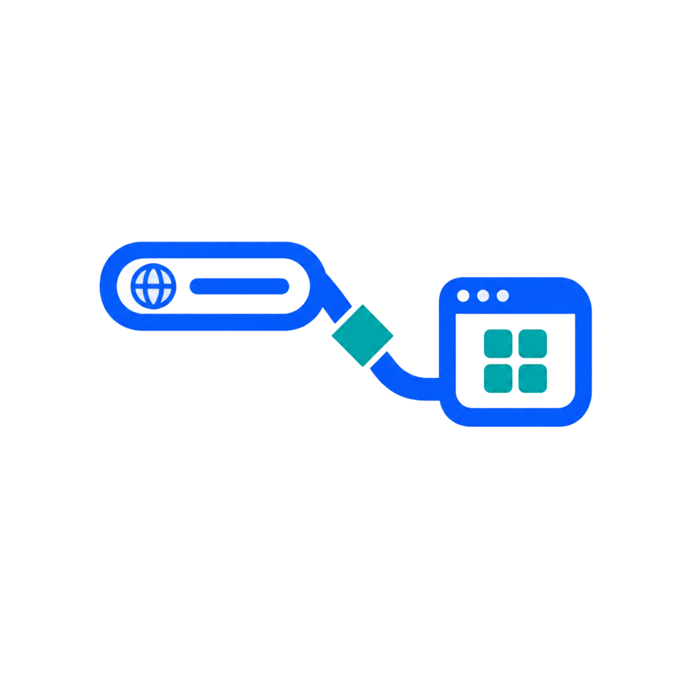

<div align="center">
  
  <p>
    <strong>Framework-agnostic deep linking for Rust</strong><br/>
    A unified API for registering custom URL schemes and receiving deep-link events across Windows, macOS, and Linux.
  </p>
  <p>
    
    
    
    
  </p>
</div>

---

Nexum provides a unified, cross-platform solution for handling custom URL schemes and deep-link events in Rust applications. A core crate handles all platform-specific complexities, while thin adapter crates expose the functionality through the idioms of your favorite UI framework.

## Ecosystem

Nexum is organized as a modular workspace to keep dependencies minimal and integrations seamless.

| Crate | Framework | Integration Mechanism |
| :--- | :--- | :--- |
| `nexum-core` | *None* | Blocking receiver (`std::sync::mpsc::Receiver`) |
| `nexum-gpui` | GPUI | `Global` trait + callback registry |
| `nexum-floem` | Floem | `ReadSignal<Option<String>>` (via `signal` feature) |
| `nexum-xilem` | Xilem | `task` view + `MessageProxy` |
| `nexum-dioxus` | Dioxus | `GlobalSignal` + `use_coroutine` |

## Platform Support

| Platform | Registration Method | Runtime Detection |
| :--- | :--- | :--- |
| **Windows** | Registry (per-user) | CLI arguments |
| **macOS** | `Info.plist` (manual setup) | Apple Events (Swift bridge) |
| **Linux** | `.desktop` file + `xdg-mime` | CLI arguments |

## Quick Start

Add the adapter for your chosen framework to your `Cargo.toml`. For example, with Floem:

```toml
[dependencies]
nexum-floem = { version = "0.1", features = ["signal"] }
```

Then, initialize the deep-link handler in your application:

```rust
use nexum_floem::setup_signal;
use nexum_core::Config;

let config = Config {
    schemes: vec!["myapp".to_string()],
    app_links: vec![],
};

// Returns a reactive `ReadSignal<Option<String>>` that updates on deep links
let url_signal = setup_signal(config);
```

> [!NOTE]
> **Under the Hood**  
> The `setup_signal` helper spawns a background thread, bridges the blocking receiver to a crossbeam channel, and uses Floem's `create_signal_from_channel` to produce a signal. This ensures the UI thread only wakes when a new URL arrives.  
> For more control (e.g., custom error handling), use the lower-level `setup` function (available without the `signal` feature) to build your own reactive signal.

## Building

The core crate builds on all three platforms with no external dependencies:

```bash
cargo build -p nexum-core
```

Adapter crates depend on their respective UI frameworks. Build them individually when the framework environment is available:

```bash
cargo build -p nexum-gpui    # requires gpui
cargo build -p nexum-floem   # requires floem
cargo build -p nexum-xilem   # requires xilem
cargo build -p nexum-dioxus  # requires dioxus
```

## Examples

Explore ready-to-run implementations for each supported framework in the `examples/` directory:

| Example | Framework | Path |
| :--- | :--- | :--- |
| `gpui-basic` | GPUI | `examples/gpui-basic/` |
| `floem-basic` | Floem | `examples/floem-basic/` |
| `xilem-basic` | Xilem | `examples/xilem-basic/` |
| `dioxus-basic` | Dioxus | `examples/dioxus-basic/` |

> [!TIP]
> For detailed setup instructions specific to your framework (especially macOS `Info.plist` configuration), refer to the individual adapter crate's README or the provided examples.
